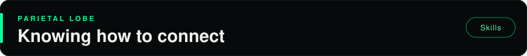
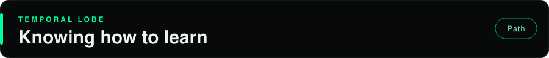
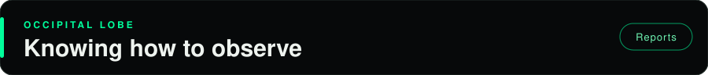
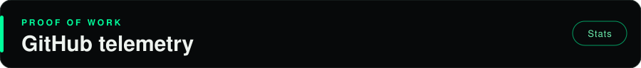
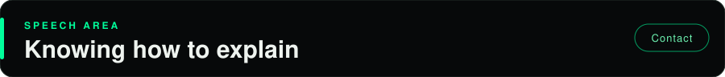

  

 

> *I would rather have five write-ups I can defend line by line than ten certification badges.*

I'm doing the **CTeSP in Networks and Computer Systems** at ISPGAYA, after a vocational degree in Information Systems Technologies at Colégio de Gaia. The goal is **cybersecurity**, built on networks, Linux and web development. I build things to understand them: a self-hosted homelab and a research blog with signed commits.

📍 Porto, Portugal · 🗣️ Native Portuguese, advanced English

**Studying now:** Linux administration and network protocols · risk management, cryptography, IAM and incident response · Python and Pascal (self-taught)

### 🆕 Latest projects

| 📅 When | 🔥 Project |
|---|---|
| **12 Nov** | 🌐 **quatro-nos**: final *Performance Report I* and project plan delivered |
| **10 Nov** | 🔐 **criptografia-na-pratica**: phases 2→5 live (asymmetric, hybrid, PGP, *and what goes wrong*) |
| **28 Oct** | 🛡️ **ZeroBirus**: [`Alpha v1.0`](https://github.com/JPFerraZzz/ZeroBirus/releases) pre-release, removal phase merged |
| **20 Oct** | 📝 **neatpad**: editor/save fixes, touch sizing, installable PWA |

<b>⚡ Live activity feed</b> <i>(auto-updated every 6 h)</i>

 

<!--START_SECTION:activity-->
<!--END_SECTION:activity-->

 

<table>
<tr>
<td width="50%" valign="top">

### 🛡️ [ZeroBirus](https://github.com/JPFerraZzz/ZeroBirus)
Security tool for Windows: **detects and removes miners, trojans and other malware** from a repair USB stick. Nothing changes without an authorised plan, no network, no telemetry.

  

</td>
<td width="50%" valign="top">

### 📓 [research-blog](https://github.com/JPFerraZzz/research-blog)
Technical write-ups on pentesting, API analysis and LLM security, with **GPG-signed commits**. Hugo behind Nginx on my own server.

  

</td>
</tr>
<tr>
<td width="50%" valign="top">

### 🔐 [criptografia-na-pratica](https://github.com/JPFerraZzz/criptografia-na-pratica)
Cryptography from a book to **demos that run in the browser**, to understand how it fails.

  

</td>
<td width="50%" valign="top">

### 📝 [neatpad](https://github.com/JPFerraZzz/neatpad)
A technical notepad for people learning and working in IT, **installable PWA** with versioned notes.

   

</td>
</tr>
<tr>
<td width="50%" valign="top">

### 🔎 [osint-theharvester-report](https://github.com/JPFerraZzz/osint-theharvester-report)
23-page technical report: what public sources reveal about **nasa.gov, rapid7.com** and a friend's server (with permission).

  

</td>
<td width="50%" valign="top">

### 🌐 [quatro-nos](https://github.com/JPFerraZzz/quatro-nos)
ISPGAYA networking lab: **4 remote nodes + 1 central**, built in Packet Tracer.

</td>
</tr>
</table>

 

**Security** &nbsp;       

**Systems** &nbsp;       

**Code** &nbsp;       

**Web** &nbsp;      

 

| When | What | Where |
|---|---|---|
| **Sep 2025 – Jun 2027** | CTeSP in Networks and Computer Systems *(NIST, ISO 27001, PKI, IAM, Linux)* | ISPGAYA · EQF 5 · ongoing |
| **Jun 2024 – May 2025** | Web Developer and Helpdesk internship, **400 h, grade 19/20** | ISPGAYA |
| **Sep 2022 – Jul 2025** | Information Systems Technologies | Colégio de Gaia · EQF 4 |

**Certificates, few and each with what I learned:** OSINT Level 1 · F1NDX (Oct 2026) · Ethics in Cybersecurity · LinkedIn Learning (Sep 2026) · AI to Boost Your Work Productivity · LinkedIn Learning (Sep 2026) · Claude 101 · Anthropic (Jul 2026)

 

**[theHarvester OSINT report](https://github.com/JPFerraZzz/osint-theharvester-report)**: three targets, one tool, public sources only. Exposed emails and internal subdomains, real IPs of InsightVM scanners, and a home server's real IP despite Cloudflare. Methodology, comparative analysis and ethics included.

 

A **Lenovo laptop running Ubuntu Server**, serving real work instead of only describing it.

| Service | Role |
|---|---|
| **Ubuntu Server, Docker, Portainer** | Services run in containers |
| **Tailscale** | Remote access over VPN, no unnecessary open ports |
| **Pi-hole + Unbound** | DNS with blocking and my own recursive resolver |
| **Fail2ban + UFW** | Firewall and automatic bans for abusive attempts |
| **Nginx + Let's Encrypt** | Reverse proxy with SSL and automatic renewal |
| **ntfy** | Monitoring with alerts sent to my phone |

 

 

I only really understand what I can explain, so I write write-ups, sign my commits and leave a simple way to talk to me. I don't publish my email or phone number: use the contact form on **[my website](https://jpferraz.netlify.app/en/)** or [LinkedIn](https://www.linkedin.com/in/jpferrazpereira/).

 

