<div align="center">



<a href="https://github.com/JPFerraZzz"></a>

<br/>

<a href="https://www.linkedin.com/in/jpferrazpereira/"></a>


</div>

<br/>

> 💬 *Five write-ups I can defend line by line > ten certification badges.*

---

## 👋 About me

```yaml
name:      João Ferraz
studying:  Networking & Systems @ ISPGAYA
location:  Porto, Portugal
leaning:   Cybersecurity  (over web dev)
building:  ZeroBirus · criptografia-na-pratica · quatro-nos
homelab:   Lenovo · Pi-hole · Nginx · Docker · Cloudflare
mindset:   build it to understand it
```

---

## 🆕 Latest projects

| 📅 When | 🔥 Project |
|---|---|
| **12 Nov** | 🌐 **quatro-nos** — final *Performance Report I* and project plan delivered |
| **10 Nov** | 🔐 **criptografia-na-pratica** — phases 2→5 live: asymmetric, hybrid, PGP, *and what goes wrong* |
| **28 Oct** | 🛡️ **ZeroBirus** — [`Alpha v1.0`](https://github.com/JPFerraZzz/ZeroBirus/releases) pre-release, removal phase merged |
| **20 Oct** | 📝 **neatpad** — editor/save fixes, touch sizing, installable PWA |

<details open>
<summary><b>⚡ Live activity feed</b> <i>(auto-updated every 6 h)</i></summary>
<br/>

<!--START_SECTION:activity-->
1. 🎉 Merged PR [#8](https://github.com/JPFerraZzz/ZeroBirus/pull/8) in [JPFerraZzz/ZeroBirus](https://github.com/JPFerraZzz/ZeroBirus)
2. 🎉 Merged PR [#1](https://github.com/JPFerraZzz/JPFerraZzz/pull/1) in [JPFerraZzz/JPFerraZzz](https://github.com/JPFerraZzz/JPFerraZzz)
3. 💪 Opened PR [#1](https://github.com/JPFerraZzz/JPFerraZzz/pull/1) in [JPFerraZzz/JPFerraZzz](https://github.com/JPFerraZzz/JPFerraZzz)
4. 💪 Opened PR [#25](https://github.com/JPFerraZzz/ZeroBirus/pull/25) in [JPFerraZzz/ZeroBirus](https://github.com/JPFerraZzz/ZeroBirus)
5. ❌ Closed PR [#14](https://github.com/JPFerraZzz/ZeroBirus/pull/14) in [JPFerraZzz/ZeroBirus](https://github.com/JPFerraZzz/ZeroBirus)
6. 🗣 Commented on [#14](https://github.com/JPFerraZzz/ZeroBirus/pull/14#issuecomment-6987056131) in [JPFerraZzz/ZeroBirus](https://github.com/JPFerraZzz/ZeroBirus)
7. 💪 Opened PR [#20](https://github.com/JPFerraZzz/ZeroBirus/pull/20) in [JPFerraZzz/ZeroBirus](https://github.com/JPFerraZzz/ZeroBirus)
8. 💪 Opened PR [#19](https://github.com/JPFerraZzz/ZeroBirus/pull/19) in [JPFerraZzz/ZeroBirus](https://github.com/JPFerraZzz/ZeroBirus)
<!--END_SECTION:activity-->

</details>

---

## 🚀 Featured projects

<table>
<tr>
<td width="50%" valign="top">

### 🛡️ [ZeroBirus](https://github.com/JPFerraZzz/ZeroBirus)
Portable Windows tool that **detects and removes miners, trojans and other malware**.

   

[](https://github.com/JPFerraZzz/ZeroBirus)

</td>
<td width="50%" valign="top">

### 🔐 [criptografia-na-pratica](https://github.com/JPFerraZzz/criptografia-na-pratica)
Self-taught cryptography: from a book summary to **demos running in the browser and terminal**.

  

[](https://github.com/JPFerraZzz/criptografia-na-pratica)

</td>
</tr>
<tr>
<td width="50%" valign="top">

### 🌐 [quatro-nos](https://github.com/JPFerraZzz/quatro-nos)
ISPGAYA networking lab: **4 remote nodes + 1 central**, built in Packet Tracer.


[](https://github.com/JPFerraZzz/quatro-nos)

</td>
<td width="50%" valign="top">

### 🔎 [osint-theharvester-report](https://github.com/JPFerraZzz/osint-theharvester-report)
OSINT investigation with theHarvester — **nasa.gov, rapid7.com** and a personal server.


[](https://github.com/JPFerraZzz/osint-theharvester-report)

</td>
</tr>
</table>

---

## 🧰 Tech stack

<div align="center">

      

     

     

</div>

---

## 📊 GitHub stats

<div align="center">


</div>

### 📈 Activity graph


---

## 🐍 Contribution snake

<div align="center">
  
</div>

---

<div align="center">

**Networks · malware analysis · applied cryptography · OSINT · homelabs**


</div>
